<!-- MORFEU / GITHUB PROFILE README -->

  

<h1>hello, world. i'm morfeu</h1>

<strong>Computer Science Student &nbsp;·&nbsp; Systems Consultant &nbsp;·&nbsp; Aspiring Full-Stack Developer</strong>

  <picture>
    <source media="(prefers-color-scheme: dark)" srcset="https://readme-typing-svg.demolab.com?font=JetBrains+Mono&size=15&duration=2800&color=A3A3A3&center=true&vCenter=true&repeat=true&width=520&height=30&pause=1200&lines=systems+%2F+code+%2F+curiosity;java+%C2%B7+spring+%C2%B7+postgresql;troubleshooting+%C2%B7+documentation+%C2%B7+security;i+like+to+know+why+something+works." />
    
  </picture>

  
  
  

 

## `01 / about me`

I'm **Kevyn**, but you can call me **Morfeu**. I'm a Computer Science student in Brazil and a **Systems Consultant**, working with troubleshooting, user support, incident analysis, system validation and technical documentation.

On the development side, I'm building my foundation in **Java**, **object-oriented programming**, programming logic and **Spring Boot** fundamentals. My goal is full-stack development, with a growing interest in **information security** and in how complex systems fit together.

> *I like to know why something works, not just that it works.*

 

## `02 / currently`

<table>
  <tr>
    <td width="140"><strong>Work</strong></td>
    <td>Systems consulting · troubleshooting, incident analysis and documentation</td>
  </tr>
  <tr>
    <td><strong>Learning</strong></td>
    <td>Programming logic · Java · OOP · Spring fundamentals</td>
  </tr>
  <tr>
    <td><strong>Exploring</strong></td>
    <td>Full-stack development · information security</td>
  </tr>
  <tr>
    <td><strong>Based in</strong></td>
    <td>Brazil</td>
  </tr>
  <tr>
    <td><strong>Mindset</strong></td>
    <td>dreamer.exe — forever curious</td>
  </tr>
</table>

 

## `03 / tools of the trade`

<table>
  <tr>
    <td width="200"><strong>Learning &amp; building with</strong></td>
    <td>
      
      
      
      
    </td>
  </tr>
  <tr>
    <td><strong>Environment</strong></td>
    <td>
      
      
    </td>
  </tr>
  <tr>
    <td><strong>Everyday tools</strong></td>
    <td>
      
      
    </td>
  </tr>
</table>

 

## `04 / featured projects`

<table>
  <tr>
    <td width="50%" valign="top">
      <h3>Vehicle Rental System</h3>
      
<code>Java</code> · <code>OOP</code> · University project (collaborative)

      
Debugged and documented a vehicle rental system and extended its object-oriented model to support a broader fleet.

      
<a href="https://github.com/Morfeuxz"><strong>View source code ↗</strong></a>

    </td>
    <td width="50%" valign="top">
      <h3>Morfeu / Profile README</h3>
      
<code>Markdown</code> · <code>GitHub Actions</code> · Personal project

      
The repository behind this profile, with workflows that generate the stats card and the animated Bomberman contribution graph.

      
<a href="https://github.com/Morfeuxz/Morfeuxz"><strong>View profile repository ↗</strong></a>

    </td>
  </tr>
</table>

 

## `05 / github activity`

<picture>
  <source media="(prefers-color-scheme: dark)" srcset="https://github-readme-stats.vercel.app/api?username=Morfeuxz&show_icons=true&include_all_commits=true&bg_color=0A0A0A&text_color=D4D4D4&title_color=F5F5F5&icon_color=A3A3A3&border_color=262626&disable_animations=true&hide_border=false" />
  
</picture>

<picture>
  <source media="(prefers-color-scheme: dark)" srcset="https://github-readme-streak-stats-eight.vercel.app/?user=Morfeuxz&theme=dark&background=0A0A0A&border=262626&stroke=262626&ring=A3A3A3&fire=D4D4D4&currStreakNum=F5F5F5&sideNums=F5F5F5&currStreakLabel=D4D4D4&sideLabels=D4D4D4&dates=A3A3A3&card_width=467" />
  
</picture>

Cards from third-party services may be briefly offline. <a href="https://raw.githubusercontent.com/Morfeuxz/Morfeuxz/stats-output/stats.svg">View the stats card generated by this repository's workflow ↗</a>

<!--
Enable this card when the public language widget returns data.

  

-->

 

<em>every contribution is another step forward.</em>

<picture>
  <source media="(prefers-color-scheme: dark)" srcset="https://raw.githubusercontent.com/Morfeuxz/Morfeuxz/pacman-output/bomberman-contribution-graph-dark.svg?game=bomberman" />
  <source media="(prefers-color-scheme: light)" srcset="https://raw.githubusercontent.com/Morfeuxz/Morfeuxz/pacman-output/bomberman-contribution-graph.svg?game=bomberman" />
  
</picture>

 

## `06 / open to opportunities`

I'm looking for **internship and junior opportunities** in software development, where I can grow in Java and back-end/full-stack work while bringing my background in systems support, incident analysis and technical documentation.

The best way to reach me is through [LinkedIn](https://www.linkedin.com/in/kevynmurillo/).

 

  <a href="https://www.linkedin.com/in/kevynmurillo/"><strong>LinkedIn</strong></a>
  &nbsp;·&nbsp;
  <a href="https://youtube.com/@godmorfeu?si=bynAXB8MKX3cgb7v"><strong>YouTube</strong></a>
  &nbsp;·&nbsp;
  <a href="https://discord.com/users/1084598707179237496"><strong>Discord</strong></a>

Kevyn "Morfeu" · Computer Science Student · Systems Consultant

games · music · philosophy · technology

<a href="#readme">back to top ↑</a>

