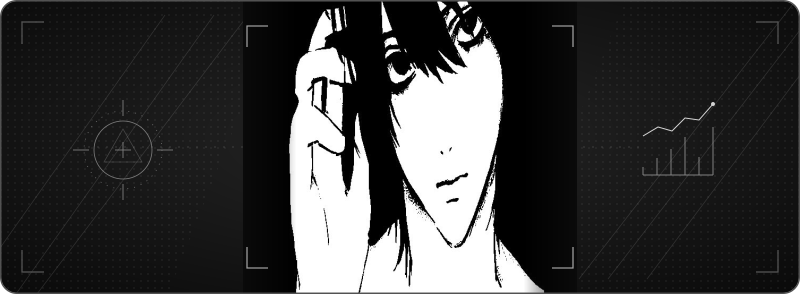

<!-- MORFEU / GITHUB PROFILE README -->

<h1>hello, world. i'm morfeu</h1>

<strong>Systems Consultant · Computer Science Student</strong> 
Kevyn · Brazil · Learning back-end and full-stack development

  <a href="https://www.linkedin.com/in/kevynmurillo/"><strong>LinkedIn</strong></a> ·
  <a href="https://youtube.com/@godmorfeu?si=bynAXB8MKX3cgb7v">YouTube</a> ·
  <a href="https://discord.com/users/1084598707179237496">Discord</a>

<h2></h2>

I'm **Kevyn**, but you can call me **Morfeu**. I study Computer Science in Brazil and work as a **Systems Consultant**. I support users, troubleshoot system issues, analyze incidents, validate system behavior, and document solutions.

I'm building a foundation in **Java**, **object-oriented programming**, programming logic, and **Spring Boot** as I work toward back-end and full-stack development. I'm also interested in information security and how complex systems fit together.

> I like to know **why** something works, not just that it works.

<h2></h2>

| Focus | In practice |
| :--- | :--- |
| **Work** | Systems support, incident analysis, and technical documentation |
| **Study** | Java, OOP, programming logic, and Spring Boot fundamentals |
| **Explore** | Back-end, full-stack development, and information security |

<h2></h2>

**Learning & building with**  
<kbd>Java</kbd> <kbd>Spring</kbd> <kbd>PostgreSQL</kbd> <kbd>Git</kbd>

**Everyday environment**  
<kbd>Windows</kbd> <kbd>Linux</kbd> <kbd>IntelliJ IDEA</kbd> <kbd>Notion</kbd>

<h2></h2>

### [Vehicle Rental System ↗](https://github.com/erickfernandesgit/Trabalho-depuracao-w-morfina)

**Java · OOP · Collaborative university project**  
Debugging and documenting a vehicle rental system and extending its object-oriented model to handle more vehicle types.

### [Morfeu / Profile README ↗](https://github.com/Morfeuxz/Morfeuxz)

**Markdown · SVG · GitHub Actions**  
The source for this profile, its visual assets, and the workflows that generate the stats card and Bomberman contribution graph.

<h2></h2>

  

    
  

  

    
  

  
<a href="https://github.com/Morfeuxz?tab=overview">View activity directly on GitHub ↗</a>

<h2></h2>

  
every contribution is another step forward.

  <picture>
    <source media="(prefers-color-scheme: dark)" srcset="https://raw.githubusercontent.com/Morfeuxz/Morfeuxz/pacman-output/bomberman-contribution-graph-dark.svg?game=bomberman" />
    <source media="(prefers-color-scheme: light)" srcset="https://raw.githubusercontent.com/Morfeuxz/Morfeuxz/pacman-output/bomberman-contribution-graph.svg?game=bomberman" />
    
  </picture>
  

<h2></h2>

I'm open to **internships and junior opportunities in software development**, especially work where I can grow in Java and bring my experience in systems support. [LinkedIn](https://www.linkedin.com/in/kevynmurillo/) is the best place to reach me about work.

  
  
games · music · philosophy · technology

